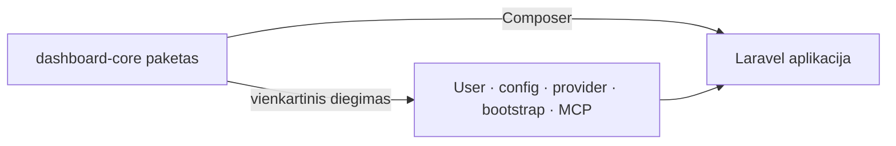

# Laravel Dashboard

Privatus `dkvadratu/dashboard-core` Composer paketas naujiems Laravel administravimo projektams. Bendras dashboard funkcijas įdiegi vieną kartą ir vėliau atnaujini per Composer. Kiekviena aplikacija turi savo Git repozitoriją, nustatymus ir versiją.

**Reikalavimai:** PHP 8.5+, Composer, Laravel 13, Filament 5 ir SSH prieiga prie privačios paketo repozitorijos. Automatinis diegiklis skirtas nepakeistam `laravel/laravel` 13.11.0 skeleton.



## Kas įeina

- Filament su el. pašto ir programėlės MFA, recovery kodais, IP ribojimu ir `is_admin` prieiga.
- Log Viewer, Sentry integracija, API ir HTTP užklausų žurnalas.
- Database queue peržiūra, aplikacijos cache valymas, README/CHANGELOG ir versijos rodymas.
- Production klaidų atsakymai, slepiantys exception informaciją.
- Users MCP serverio pavyzdys, Sanctum autentifikacija ir tokenų valdymo langas.
- Pasirenkamas viešųjų URL nukreipimų modulis: `dashboard:install-redirects`.
- Atskira dev įrankių diegimo seka: Debugbar, Boost, Pint, Pest.

## 1. Sukurk aplikaciją

Paketo repozitorijoje turi būti paskelbta `v1.0.0` arba naujesnė suderinama `v1.x` versija. SSH prieigos reikia ir kūrėjui, ir deployment/CI aplinkai.

```bash
composer create-project laravel/laravel mano-dashboard 13.11.0
cd mano-dashboard
composer config repositories.dashboard-core vcs git@github.com:dkvadratu/dashboard-core.git
composer require 'dkvadratu/dashboard-core:^1.0'

composer config allow-plugins.pestphp/pest-plugin true
composer require --dev 'barryvdh/laravel-debugbar:^4.2' 'laravel/boost:^2.10' 'laravel/pint:^1.0' 'pestphp/pest:^4.0' 'pestphp/pest-plugin-laravel:^4.0' --with-all-dependencies

php artisan dashboard:install --fresh --no-interaction
```

Laravel, Filament, Log Viewer, Sentry, **Laravel MCP ir Sanctum** yra paketo `require` priklausomybės, todėl įdiegiamos ir production aplinkoje. Dev įrankius diegiame aplikacijoje, nes priklausomybių `require-dev` Composer neįdiegia.

## 2. Užbaik nustatymus

1. `.env` nustatyk `APP_NAME`, `APP_URL`, DB, `MAIL_*`, `DASHBOARD_ALLOWED_IPS` ir `APP_VERSION`. Leidžiami IP gali būti ir CIDR; numatyta `127.0.0.1,::1`. Dashboard užklausoms iš neleistinų IP grąžinamas 404.
2. Sukurk Sentry projektą ir įrašyk `SENTRY_LARAVEL_DSN`. Exception integracija jau prijungta.
3. Paleisk migracijas, paruošk Filament failus ir sukurk administratorių:

```bash
php artisan migrate --no-interaction
php artisan filament:assets --no-interaction
php artisan make:filament-user
php artisan dashboard:admin tavo@email.lt
vendor/bin/pest --init
```

4. Aplikacijos `composer.json` į esamą `scripts.post-autoload-dump` masyvą **pridėk** `"@php artisan filament:upgrade"`, išsaugodamas jau esančias komandas.
5. Atidaryk `/adm`, patvirtink el. paštą ir nustatyk MFA. Su `MAIL_MAILER=log` laiškų turinys yra `storage/logs/laravel.log`; tikram siuntimui sukonfigūruok mail tiekėją.
6. Į aplikacijos Git įtrauk `composer.lock`, `.dashboard-installed` ir `.dashboard-mcp-installed`. `.env`, `vendor/` bei `*.dashboard-backup` kopijų neįtrauk.

Naujo vartotojo `is_admin=false`. `dashboard:admin email` suteikia prieigą; `dashboard:admin email --revoke` ją atima. El. pašto patvirtinimas ir MFA vis tiek privalomi.

## Quick tips

Šie nustatymai yra rekomendacijos: pasirink juos pagal projektą, paketas jų automatiškai nekeičia. Kodo pavyzdžius ir vietas, kur juos įdėti, rodo `php artisan dashboard:code-tips`.

| Nustatymas | Rekomendacija |
| --- | --- |
| Laiko juosta | `config/app.php` naudok `env('APP_TIMEZONE', 'UTC')`, o `.env` nustatyk `APP_TIMEZONE=UTC`. Vietinę laiko juostą parink pagal projekto poreikius. |
| Filament valiuta ir datos | `Table` ir `Schema` konfigūracijoje nustatyk `defaultCurrency('EUR')` ir `defaultDateTimeDisplayFormat('Y-m-d H:i')`. Tai numatytasis atvaizdavimo formatas; datos įvesties laukus konfigūruok atskirai. |
| Carbon mėnesiai ir metai | Mėnesio pabaigoje naudok `subMonthNoOverflow()` arba `subYearNoOverflow()`, kai data neturi persikelti į kitą mėnesį. Globalūs `Carbon::useMonthsOverflow(false)` ir `Carbon::useYearsOverflow(false)` metodai yra pasenę ir keičia bendrą elgesį. |
| Griežti modeliai | `AppServiceProvider::boot()` įjunk `Model::shouldBeStrict(! app()->isProduction())`, kad kūrimo metu pastebėtum modelių klaidas. |
| Destruktyvios DB komandos | `AppServiceProvider::boot()` naudok `DB::prohibitDestructiveCommands(app()->isProduction())`. Tai blokuoja tam tikras Artisan komandas, bet ne savavališkus SQL pakeitimus. |
| Skaičių lokalė | `AppServiceProvider::boot()` nustatyk `Number::useLocale('lt_LT')`; Filament lentelėms ir schemoms galima naudoti `defaultNumberLocale('lt_LT')`. |

## Default routes

| Kelias | Paskirtis |
| --- | --- |
| `/adm` | Filament dashboard |
| `/adm/login` | Prisijungimas |
| `/adm/queued-jobs` | Eilių peržiūra |
| `/adm/api-request-logs` | API ir HTTP Requests žurnalas |
| `/adm/logs` | Log Viewer |
| `/adm/project-readme` | Projekto README ir CHANGELOG |
| `/adm/mcp-tokens` | MCP tokenų kūrimas ir atšaukimas |
| `/adm/redirects` | Nukreipimų valdymas, tik įdiegus pasirenkamą modulį |
| `/mcp/users` | Users MCP serveris: POST su Bearer tokenu |
| `/uupp` | Laravel health check |
| `/api/status` | Pavyzdinis API statuso endpointas |

Panelės URL valdomas įprastai: `app/Providers/Filament/AdminPanelProvider.php` → `->path('adm')`. Health kelias nustatomas `bootstrap/app.php`. Vidinis Filament panel ID – `admin`.

## MCP: pirmas prisijungimas

1. Atlik migracijas ir prisijunk prie `/adm` su administratoriumi bei MFA.
2. Atidaryk **System → MCP tokens → Create token**. Įrašyk kliento pavadinimą, teises ir galiojimą (30, 90 arba 365 dienos). Numatytai pasirinkta tik `users:read`.
3. Nukopijuok parodytą tokeną: jis rodomas **vieną kartą**, DB saugomas jo hash. Pirmą kartą automatiškai sukuriamas `Dashboard AI` vartotojas; vėlesni tokenai priklauso tam pačiam vartotojui.
4. MCP kliente pasirink HTTP transportą, savo aplikacijos `/mcp/users` URL ir antraštę `Authorization: Bearer <token>`. Production naudok HTTPS. Tokeno nelaikyk Git ar URL.
5. Prisijungęs klientas ras `list-users` ir `create-user`. Tokeną panaikinsi to paties lango **Revoke** veiksmu.

AI vartotojo el. paštas nustatomas per `config/dashboard.php` → `mcp_user_email` (numatyta `dashboard-ai@example.invalid`). Tai techninė paskyra su atsitiktiniu, neatskleidžiamu slaptažodžiu, `is_mcp_service_account=true` ir `is_admin=false`. Jai administravimo prieiga draudžiama. Jei šis el. paštas jau priklauso paprastam vartotojui, parink kitą; esama paskyra neperimama. Diegimas iš anksto tokeno nekuria.

| Įrankis | Teisė | Rezultatas |
| --- | --- | --- |
| `list-users` | `users:read` | ID, vardas, el. paštas; `limit` 1–100, numatyta 20; kitam puslapiui perduok `next_after_id` kaip `after_id` |
| `create-user` | `users:create` | Naujas paprastas, nepatvirtintas vartotojas pagal `name` ir `email`; nesuteikia admin teisių ir negrąžina slaptažodžio |

Sukurtam vartotojui slaptažodį vėliau nustatyk per konkrečios aplikacijos slaptažodžio atkūrimo / pakvietimo eigą. Pavyzdinis įrankis laiško nesiunčia.

Serveris registruojamas `routes/ai.php` su `api`, `auth:sanctum`, `EnsureMcpToken` ir užklausų dažnio ribojimu. Reikalingas galiojantis AI paskyros tokenas su `mcp` teise; kiekvienas įrankis papildomai tikrina savo teisę. Vien prisijungimo sesijos neužtenka. `mcp` teisę tokenų langas prideda automatiškai.

Greitas patikrinimas terminale, kai `MCP_URL` yra tavo pilnas endpointas, o `MCP_TOKEN` – nukopijuotas tokenas:

```bash
curl "$MCP_URL" \
  -H "Authorization: Bearer $MCP_TOKEN" \
  -H 'Content-Type: application/json' \
  -H 'Accept: application/json, text/event-stream' \
  --data '{"jsonrpc":"2.0","id":1,"method":"tools/list","params":{}}'
```

Klientas turi palaikyti rankiniu būdu nustatomą Bearer antraštę. Šis pavyzdys neįdiegia OAuth prisijungimo ar automatinės klientų registracijos.

### Kaip pridėti savo MCP serverį

Aplikacijai priklauso `app/Mcp/Servers/UsersServer.php`, `app/Mcp/Tools/ListUsers.php`, `app/Mcp/Tools/CreateUser.php` ir `routes/ai.php`. Composer atnaujinimas jų neperrašo.

1. Pagal šiuos failus kopijuok pavyzdį arba generuok `php artisan make:mcp-server OrdersServer` ir `php artisan make:mcp-tool ListOrders`.
2. Aprašyk schemą, validaciją, teisės patikrą ir grąžinamą rezultatą; įrankį įtrauk į serverio `$tools`.
3. `routes/ai.php` registruok naują endpointą su tokia pačia autentifikacija.
4. Į aplikacijos `config/dashboard.php` → `mcp_token_abilities` pridėk, pvz., `'orders:read' => 'List orders'`. Tokenų langas pasiūlys šią teisę. Įrankyje tikrink `tokenCan('orders:read')`.
5. Sukurk naują tokeną su reikiamomis teisėmis ir pridėk įrankio testus.

## Boost instrukcijos ir skills

`dashboard:install --fresh` automatiškai paleidžia `dashboard:boost`: naujam projektui – `boost:install --guidelines --skills --mcp`, jau sukonfigūruotam – `boost:update`. Jei trūksta skills arba MCP konfigūracijos, paruošimas paleidžiamas dar kartą. Esami agentų pasirinkimai išsaugomi; jei jų nėra, numatytas **Codex**. Kitus agentus pasirink per interaktyvų `php artisan boost:install`.

Boost turi būti įdiegtas aplikacijoje kaip dev priklausomybė **prieš** starterio diegimą. Jei jo trūksta arba reikia atnaujinti:

```bash
composer require --dev 'laravel/boost:^2.10' --with-dependencies
php artisan dashboard:boost --no-interaction
```

`dashboard:boost` vykdyk ir po paketo / dev priklausomybių atnaujinimo. Peržiūrėk sugeneruotus `AGENTS.md`, agentų MCP konfigūraciją ir skills. Diegiant aplinkoje be dev įrankių galima naudoti `dashboard:install --fresh --without-boost`; Boost paruošk kūrimo aplinkoje.

### WWTD skill ir Git

Pakete yra **WWTD — What Would Taylor Otwell Do?** skill: Laravel konvencijų, paprastumo ir framework galimybių naudojimo gairės. Jis aktyvuojamas sprendžiant architektūros, kodo struktūros ar alternatyvų pasirinkimo klausimus; aplikacijos veikimo nekeičia.

- **Paketo Git:** originalas `resources/boost/skills/wwtd/SKILL.md`. Tai įprastas versijuojamas Markdown failas, platinamas kartu su Composer paketu per [Boost third-party skills](https://laravel.com/docs/13.x/boost#third-party-package-skills).
- **Automatinis diegimas:** `dashboard:boost` įtraukia `dkvadratu/dashboard-core` į `boost.json` paketų pasirinkimą ir išsaugo kitus pasirinkimus. Boost įdiegia skillą pasirinktiems agentams; Codex atveju – `.agents/skills/wwtd/SKILL.md`.
- **Aplikacijos Git:** galima commitinti `boost.json` ir projekto skills, kad komanda turėtų tas pačias gaires. Sugeneruotų skills tiesiogiai neredaguok: Boost juos atnaujina. Asmeninis `~/.codex/skills/` katalogas į repozitoriją nekeliamas.
- **Projekto išimtis:** jei reikia savo WWTD varianto, laikyk jį `.ai/skills/wwtd/SKILL.md` ir commitink aplikacijoje. Boost šiam failui teikia pirmenybę prieš paketo variantą.

Atnaujinimo eiga:

1. Bendrą WWTD keisk paketo `resources/boost/skills/wwtd/SKILL.md` ir išleisk naują paketo versiją.
2. Aplikacijoje atlik žemiau aprašytą paketo atnaujinimą, įskaitant `php artisan dashboard:boost --no-interaction`.
3. Peržiūrėk skills pakeitimus ir commitink juos, jei aplikacijoje juos versijuoji. Projekto `.ai/skills/wwtd/` išimtį suderink rankomis.

**Skirtingos paskirtys:** `php artisan boost:mcp` teikia kūrimo įrankius tavo IDE agentui; `/mcp/users` teikia aplikacijos įrankius išoriniam klientui su Sanctum tokenu. Boost production aplinkoje nereikalingas.

## Jei projektas turi viešąją svetainę / public routes

Šiame skyriuje – pasirenkamas paketo nukreipimų modulis ir papildomų paketų rekomendacijos projektams su lankytojams skirtais puslapiais. Papildomi paketai automatiškai neįdiegiami.

### URL nukreipimų valdymas (pasirenkamas modulis)

Kai administratorius turi valdyti senų puslapių adresus, aplikacijos šaknyje vykdyk:

```bash
php artisan dashboard:install-redirects --no-interaction
php artisan migrate --no-interaction
php artisan optimize:clear --no-interaction
```

Filament meniu atsiras **Public web → Redirects** (`/adm/redirects`). Komanda sukuria `config/dashboard-redirects.php`, `dashboard_redirects` lentelės migraciją ir `.dashboard-redirects-installed` žymą. Šiuos failus commitink aplikacijoje. Pakartotinis diegimas esamų nustatymų neperrašo; aptikęs konfliktuojantį config ar migraciją be žymos, sustoja prieš rašymą.

Modelis `Dkvadratu\DashboardCore\Models\Redirect`, middleware ir Filament Resource lieka pakete ir atnaujinami per Composer. Į `bootstrap/app.php` middleware rankomis pridėti nereikia: paketas jį registruoja, kai `dashboard-redirects.enabled=true`. Neįdiegus modulio, nėra jo lentelės, Filament Resource ar middleware. Išjungti galima config reikšme `enabled=false`, po to atnaujinant konfigūracijos ir maršrutų talpyklas.

**Taisyklė:** `source=/senas`, `destination=/naujas`, `status_code=301` arba `302`, `enabled` ir neprivaloma `redirect_valid_until`. 301 skirtas nuolatiniam pakeitimui, 302 – laikinam. Naudok tikslius svetainės vidinius kelius su pradiniu `/`, be galinio `/` (išskyrus šakninį `/`). Wildcard, išoriniai URL, procentais koduoti keliai, query ir fragmentai taisyklėse nepalaikomi. Užklausos query parametrai į naują adresą neperkeliami.

- Taikoma GET/HEAD prieš maršruto vykdymą, todėl veikia ir senam URL, kuriam maršruto jau nebėra. Taisyklė turi pirmenybę ir prieš tebeegzistuojantį viešą maršrutą.
- Praleidžiamos Ajax, JSON, `X-Livewire` ir `Authorization` užklausos. Visada saugomi Filament panelių keliai, `/adm`, `/admin`, `/api`, `/mcp`, Livewire, `/uupp`, `/up`, Sanctum, Debugbar ir Boost keliai.
- Projekto kitokius API/MCP/health adresus bei privačių puslapių prefiksus įrašyk į `config/dashboard-redirects.php` → `except`. Ten jau yra prisijungimo, paskyros ir krepšelio keliai. Prefiksas apima ir jo subkelius; nekurk taisyklių privatiems puslapiams.
- Unikalūs šaltiniai ir ciklai tikrinami išsaugant; ciklų tikrinimas apima ir išjungtas / pasibaigusias taisykles. Middleware papildomai aptinka ciklą vykdymo metu ir tokios taisyklės netaiko.
- Taisyklės laikomos aplikacijos cache iki `cache_seconds` (numatyta 300 s). Modelio sukūrimas, redagavimas ir trynimas išvalo tik nukreipimų talpyklą, taip pat po DB transakcijos commit. Galiojimas tikrinamas per kiekvieną užklausą; po rollback neužsilaiko nepatvirtintų pakeitimų talpykla.
- `record_hits=false` pagal nutylėjimą. Įjungus, Filament rodo `hits`; skaičius didinamas po atsakymo tame pačiame PHP procese, be queue workerio. Tai nėra tikslus lankytojų skaitiklis: naršyklės ar CDN kešuojami nukreipimai gali nepasiekti aplikacijos. Laikinam galiojimui rinkis 302, nes 301 gali likti kliento talpykloje.

Keisdamas taisykles kode naudok modelio `save()` / `delete()`. Masiniai SQL pakeitimai ir `saveQuietly()` apeina validaciją bei cache įvykius; importus validuok ir po jų kviesk `Redirect::clearCache()`. Globalus middleware turi veikti prieš papildomai prijungtą viso atsakymo kešavimą.

**Atnaujinimas:** atnaujink `dkvadratu/dashboard-core` per Composer, pritaikyk release pastabose nurodytas config / migracijų pataisas, paleisk migracijas ir išvalyk cache pagal bendrą atnaujinimo eigą. `dashboard:install-redirects` pakartotinai vykdyti nereikia. Jau paskelbtos migracijos ir config priklauso aplikacijai; jų nauja paketo versija neperrašo.

### Viešųjų puslapių kešavimas

Kai viešųjų puslapių turinys kartojasi, rekomenduojama naudoti [spatie/laravel-responsecache](https://github.com/spatie/laravel-responsecache). Paketas išsaugo visą HTTP atsakymą, todėl pakartotinėms užklausoms puslapio nereikia generuoti iš naujo. Tinka, pavyzdžiui, naujienoms, informaciniams puslapiams ar viešam katalogui.

Pasirinkęs šį paketą, aplikacijoje vykdyk:

```bash
composer require spatie/laravel-responsecache
php artisan vendor:publish --tag=responsecache-config --no-interaction
```

Toliau pagal [oficialią dokumentaciją](https://spatie.be/docs/laravel-responsecache/v8/introduction):

1. `Spatie\ResponseCache\Middlewares\CacheResponse` prijunk tik prie pasirinktų viešųjų GET maršrutų ar jų grupės. Šiame starteryje jo nedėk į bendrą `web` middleware grupę.
2. Nustatyk turinio atnaujinimo dažniui tinkamą galiojimo laiką ir cache store. Numatyk talpyklos išvalymą po turinio pakeitimų administravimo dalyje.
3. Į kešuojamą grupę neįtrauk `/adm`, prisijungimo, MFA, `/mcp/users`, `/uupp`, krepšelio ar kitų personalizuotų puslapių. Viešas URL savaime nereiškia, kad atsakymas visiems vienodas: patikrink kalbos, sesijos ir slapukų sutikimo įtaką turiniui.
4. Patikrink, kad po turinio pakeitimo lankytojai matytų atnaujintą puslapį, o skirtingų lankytojų duomenys nesimaišytų.

### Slapukų valdymas ir BDAR

Kai projektui reikia slapukų ir naudotojo sutikimų valdymo, rekomenduojama naudoti [dkvadratu/Laravel-cookie-consent](https://github.com/dkvadratu/Laravel-cookie-consent). Diegimo ir konfigūravimo instrukcijas žiūrėk paketo README; konfigūraciją pritaikyk konkretaus projekto BDAR reikalavimams.

Tai pasirenkamas aplikacijos paketas: `dashboard-core` jo automatiškai neįdiegia. Slapukų sutikimų valdymas yra viena BDAR atitikties dalis, todėl vien paketo įdiegimas visos atitikties neužtikrina.

## Modelių pokyčių istorija (pasirenkama)

Kai keli administratoriai keičia duomenis ir reikia matyti **kas, ką ir kada pakeitė**, rekomenduojama naudoti [spatie/laravel-activitylog](https://github.com/spatie/laravel-activitylog). Žurnalas gali saugoti pakeitimo autorių, modelį, įvykį ir laukų reikšmes prieš / po pakeitimo. `dashboard-core` šios priklausomybės automatiškai neįdiegia.

Stebėjimą junk prie **keičiamo modelio**: `User` – paskyrų pokyčiams, `Order` – užsakymams ir t. t. Prisijungęs vartotojas yra pakeitimo autorius (`causer`); vien stebint `User`, kitų modelių pokyčiai nebus registruojami. Bendro bazinio modelio su visų laukų registravimu nereikia.

### 1. Įdiek aplikacijoje

Pavyzdys skirtas **Spatie v5, Laravel 13 ir Filament 5**. V4 turi kitus namespace, metodus ir pokyčių lauką; esamą v4 diegimą atnaujink pagal [oficialią atnaujinimo instrukciją](https://github.com/spatie/laravel-activitylog/blob/main/UPGRADING.md).

```bash
composer require 'spatie/laravel-activitylog:^5.1'
php artisan vendor:publish --provider='Spatie\Activitylog\ActivitylogServiceProvider' --tag=activitylog-migrations --no-interaction
php artisan vendor:publish --provider='Spatie\Activitylog\ActivitylogServiceProvider' --tag=activitylog-config --no-interaction
php artisan migrate --no-interaction
```

### 2. Prijunk prie modelio

Esamo `app/Models/User.php` viršuje pridėk importus:

```php
use Spatie\Activitylog\Models\Concerns\LogsActivity;
use Spatie\Activitylog\Support\LogOptions;
```

**Esamos `User` klasės viduje** pridėk traitą ir metodą, išsaugodamas jau esančius MFA, Sanctum ir kitus traitus bei metodus:

```php
use LogsActivity;

public function getActivitylogOptions(): LogOptions
{
    return LogOptions::defaults()
        ->useLogName('users')
        ->logOnly(['name', 'email', 'is_admin'])
        ->logOnlyDirty()
        ->dontLogEmptyChanges();
}
```

Tai registruos sukūrimą, pakeitimą ir ištrynimą; keičiant bus saugomi tik pasikeitę pasirinkti laukai. Kitam modeliui pakeisk `useLogName()` ir `logOnly()` sąrašą. Slaptažodžių, tokenų, MFA paslapčių ir recovery kodų reikšmių į jį netrauk. `$fillable` keisti nereikia.

### 3. Pridėk istorijos veiksmą Filament lentelėje

Pavyzdys skirtas tavo aplikacijos `UserResource` lentelei (jei jos dar nėra, sukurk ją savo projekte). Lentelę aprašančio failo viršuje pridėk:

```php
use App\Models\User;
use Filament\Actions\Action;
use Filament\Facades\Filament;
use Filament\Forms\Components\Textarea;
use Spatie\Activitylog\Models\Activity;
```

Į **esamą** `$table->recordActions([...])` masyvą įdėk šį veiksmą, palikdamas jau turimus Edit / Delete veiksmus:

```php
Action::make('history')
    ->label('Pokyčių istorija')
    ->authorize(fn (): bool => (bool) Filament::auth()->user()?->is_admin)
    ->slideOver()
    ->modalHeading('Kas, ką ir kada pakeitė')
    ->modalDescription('Rodoma iki 50 naujausių šio įrašo įvykių.')
    ->modalSubmitAction(false)
    ->modalCancelActionLabel('Uždaryti')
    ->schema([
        Textarea::make('history')->label('Istorija')->rows(20)->readOnly(),
    ])
    ->fillForm(fn (User $record): array => [
        'history' => json_encode(
            $record->activitiesAsSubject()
                ->with('causer')
                ->orderByDesc('id')
                ->limit(50)
                ->get()
                ->map(fn (Activity $activity): array => [
                    'kada' => $activity->created_at
                        ->setTimezone(config('app.timezone'))->toDateTimeString(),
                    'kas' => $activity->causer?->name ?? 'Sistema / autorius nepasiekiamas',
                    'autoriaus_id' => $activity->causer_id,
                    'ivykis' => $activity->event,
                    'pries' => $activity->attribute_changes?->get('old', []),
                    'po' => $activity->attribute_changes?->get('attributes', []),
                ])->all(),
            JSON_PRETTY_PRINT | JSON_UNESCAPED_UNICODE | JSON_THROW_ON_ERROR,
        ),
    ]),
```

Veiksmas rodo tik pasirinkto įrašo istoriją ir leidžiamas administratoriams. Kitai lentelei pakeisk `User` tipą į jos modelį; prieigos taisyklę pritaikyk projekto policy / tenant riboms. Didesnei istorijai naudok atskirą puslapiuojamą Activity lentelę.

### 4. Patikrink ir nustatyk saugojimą

Prisijunk vienu administratoriumi, pakeisk kito vartotojo vardą ir atidaryk jo istoriją: matysi autorių, laiką, seną ir naują vardą. Tuščias išsaugojimas neturi sukurti naujo pokyčio įrašo. Istorija kaupiama tik nuo stebėjimo įjungimo.

Įprastoje autentifikuotoje užklausoje autorius nustatomas iš aktyvaus auth guard. Queue / CLI atveju nėra automatinio prisijungusio administratoriaus: jei veiksmas vykdomas jo vardu, perduok autoriaus ID ir vykdymo metu aiškiai nustatyk autorių, pvz., v5 `Activity::defaultCauser($admin, fn () => $order->update([...]))`. Bendra AI paskyra istorijoje bus matoma kaip AI paskyra, o ne konkretus žmogus.

`config/activitylog.php` nustatyk `clean_after_days`, o `routes/console.php` suplanuok `Schedule::command('activitylog:clean --force --no-interaction')->daily();` su `Illuminate\Support\Facades\Schedule` importu. Tai atskira istorija nuo HTTP/API žurnalo ir jo saugojimo nustatymų.

Tiesioginės SQL, masinės Eloquent `update` / `delete` operacijos ir įvykius nutildantys metodai nepaleidžia įprasto modelių stebėjimo. Tokiems veiksmams numatyk atskirą įrašą. Žr. [Laravel modelių įvykius](https://laravel.com/docs/13.x/eloquent#events).

## Requests logger

Tik trys `.env` jungikliai; numatytai visi `false`. Pavyzdys, įjungiantis API metaduomenų registravimą:

```dotenv
DASHBOARD_LOG_API=true
DASHBOARD_LOG_HTTP=false
DASHBOARD_LOGS_DETAILED=false
```

`config/dashboard.php` atitikmenys: `log_api_requests`, `log_http_requests`, `log_detailed`. API – `/api`, `/api/*` arba maršrutai su `api` middleware. HTTP – likusios įeinančios užklausos, įskaitant administraciją ir Livewire. Išeinantys `Http::` kvietimai neįtraukti.

Paprastas režimas saugo tipą, metodą, kelią, statusą ir IP. Detalus papildomai saugo request/response **Headers**, JSON kūnus ir URL-encoded request formas. Slaptos antraštės ir `redacted_keys` laukai maskuojami; papildyk sąrašą pagal projektą. Query string, HTML, multipart ir failai nesaugomi; >64 KiB kūnai ar antraščių blokai praleidžiami. URL keliuose nelaikyk slaptų tokenų.

Įrašų saugojimo trukmė – `log_retention_days` (numatyta 14 dienų). `dashboard:prune-logs` suplanuotas kasdien.

## Queue ir cache

Queue langas naudoja aktyvią `QUEUE_CONNECTION`. `database` driveriui rodomi laukiantys ir rezervuoti darbai. **Redis atveju rodomas pranešimas, kad užduočių atvaizduoti negalime**; DB eilė neskaitoma. Kitiems nepalaikomiems driveriams taip pat rodomas pranešimas.

Cache veiksmas kviečia `Cache::flush()`. Numatytą cache store skirk tik šiai aplikacijai.

### Filament 2FA ir Laravel talpykla

Jei el. pašto 2FA kodo galiojimo data talpykloje saugoma kaip objektas, draudžiant atkurti visas klases net naujas kodas gali būti atmestas. `config/cache.php` leidžiamos tik šios datos klasės:

```php
'serializable_classes' => [
    \Illuminate\Support\Carbon::class,
    \Carbon\CarbonImmutable::class,
],
```

Kitos klasės lieka neleidžiamos. Nustatymas aktualus `file` ir `database` talpykloms; naujas diegimas jį įrašo automatiškai. Esamose aplikacijose pritaikyk rankomis ir paleisk `php artisan config:clear --no-interaction`. Jei diegime naudojamas config cache, atkurk jį per `php artisan config:cache --no-interaction`.

Filament versijos, kurios datą saugo tekstu, šio objektų atkūrimo apribojimo nepatiria; sąrašas užtikrina suderinamumą su datos objektus saugančiomis realizacijomis ir ankstesniais įrašais.

## Kas lieka aplikacijoje

`dashboard:install --fresh` vieną kartą paruošia User su MFA/`is_admin` migracija, panel provider, bootstrap, cache ir dashboard konfigūraciją, API ir MCP pavyzdžius, Sanctum tokenų ir AI vartotojo migracijas bei `.env` kintamuosius. Esamus README/CHANGELOG palieka; trūkstamus sukuria. Versija rodoma pagal aplikacijos `APP_VERSION`.

Diegiklis patikrina nepakeistus skeleton failus, padaro jų atsargines kopijas ir išsaugo `.dashboard-installed` žymą. Pakartotinai aplikacijos failų nekeičia; atnaujina tik Boost generuojamas instrukcijas ir skills, jei nepateiktas `--without-boost`. Esamą pritaikytą Laravel projektą integruok rankomis pagal `stubs/`, patikrinęs jau turimus User/MFA stulpelius.

Filament sidebar apačioje automatiškai rodoma nuoroda `v0.1.0 · README`: versija imama iš `APP_VERSION`, o paspaudus atveriamas projekto README/CHANGELOG puslapis. Versijos reikšmę keisk aplikacijoje; paketas jos automatiškai nedidina. Jei naudoji konfigūracijos talpyklą, pakeitęs reikšmę ją atnaujink pagal deployment eigą.

Bendri komponentai ir paketo lentelių migracijos lieka pakete. Aplikacijos User, nustatymai ir dokumentai po diegimo priklauso projektui.

## Atnaujinimas kiekviename projekte

1. Sukurk aplikacijos šaką ir perskaityk naujos paketo versijos release pastabas.
2. Pritaikyk jose nurodytus aplikacijos config/bootstrap/User pakeitimus. Paketo stubų pakeitimai jau įdiegtų failų automatiškai neatnaujina.
3. Aplikacijos šaknyje vykdyk:

```bash
composer update dkvadratu/dashboard-core laravel/boost --with-dependencies
php artisan migrate --no-interaction
php artisan filament:assets --no-interaction
php artisan optimize:clear --no-interaction
php artisan dashboard:boost --no-interaction
php artisan test --compact
```

4. Peržiūrėk ir commitink `composer.lock` kartu su aplikacijos pataisymais.
5. Produkcijoje diek patikrintą commit pagal žemiau pateiktą seką.

`dashboard:install` nėra atnaujinimo komanda. Neredaguok `vendor/` failų. Naudok `^1.0`; perėjimą į kitą major versiją atlik atskirai pagal jos instrukcijas.

### MCP pridėjimas ankstesniam starterio projektui

Šiuos žingsnius atlik tik kartą, jei projektas sukurtas iki MCP integracijos:

1. Atnaujink paketą per Composer ir atlik pakeitimus savo `app/Models/User.php`:
   - Pridėk `use \Laravel\Sanctum\HasApiTokens;` **klasės viduje**, prie kitų traitų.
   - Į `casts()` pridėk `'is_mcp_service_account' => 'boolean'`.
   - `canAccessPanel()` sąlygą papildyk `&& ! $this->is_mcp_service_account`. Neįtrauk šio lauko į `$fillable`.
2. Paleisk:

```bash
php artisan dashboard:install-mcp --no-interaction
php artisan migrate --no-interaction
php artisan optimize:clear --no-interaction
php artisan dashboard:boost --no-interaction
```

3. Commitink sugeneruotus MCP failus, migracijas, User pakeitimus ir `.dashboard-mcp-installed`. Patikrink tokeno sukūrimą bei MCP įrankius.

Komanda nekeičia esamų User ar MCP failų. Jei jau turi `routes/ai.php` arba to paties pavadinimo klases, ji sustoja prieš rašymą: integruok atitinkamus paketo `stubs/` pavyzdžius į savo failus rankomis, publikuok trūkstamą `sanctum-migrations` migraciją ir pridėk AI vartotojo stulpelio migraciją. Jau įdiegtame projekte pakartotinė komanda nieko neperrašo.

## Production diegimas

Nustatyk `APP_DEBUG=false`, mail, Sentry ir leidžiamus IP. Iš patikrinto aplikacijos commit vykdyk:

```bash
composer install --no-dev --optimize-autoloader --no-interaction
php artisan migrate --force --no-interaction
php artisan filament:assets --no-interaction
php artisan optimize:clear --no-interaction
php artisan optimize --no-interaction
php artisan queue:restart --no-interaction
```

Queue workerį paleisk per process manager. Laravel schedulerį (`php artisan schedule:run`) vykdyk kas minutę. Horizon/Octane procesus perkrauk pagal projekto deployment eigą. Patikimus reverse proxy nustatyk aplikacijoje.

## Naujos paketo versijos išleidimas

1. Paketo repozitorijoje pakeisk bendrą kodą. DB pakeitimams pridėk naujas migracijas.
2. Patikrink paketą su jį naudojančia testine Laravel aplikacija ir jos integraciniais testais.
3. Release pastabose aprašyk pakeitimus ir reikalingus rankinius aplikacijos failų atnaujinimus.
4. Commitink ir paskelbk naują SemVer tag. Pavyzdys, kai `v1.0.0` jau išleista:

```bash
git add .
git commit -m "Update dashboard core"
git tag v1.1.0
git push origin main
git push origin v1.1.0
```

Pirmam leidimui naudok `v1.0.0`. Aplikacijos naują versiją gauna per aukščiau aprašytą Composer atnaujinimo eigą.

## Repozitorijos turinys

Ši repozitorija skirta Composer paketui. Jos šaknyje:

```text
composer.json
README.md
src/
config/
database/migrations/
resources/views/
resources/boost/skills/wwtd/SKILL.md
stubs/
```

Aplikacijų kodas, jų `.env`, duomenų bazės ir `vendor/` laikomi atskirai. Kiekvienas būsimas projektas įsidiegia šį paketą per Composer; paketo repozitorijos forkinti nereikia.

## Dokumentacija

[Laravel MCP ir Sanctum autentifikacija](https://laravel.com/docs/13.x/mcp#sanctum) · [Sanctum tokenai](https://laravel.com/docs/13.x/sanctum#api-token-authentication) · [Laravel Boost](https://laravel.com/docs/13.x/boost)
